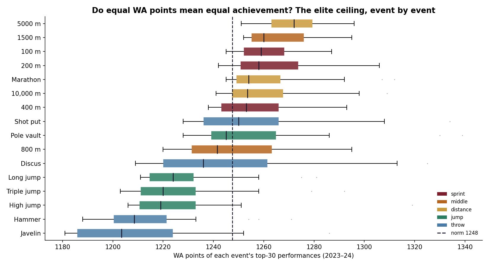
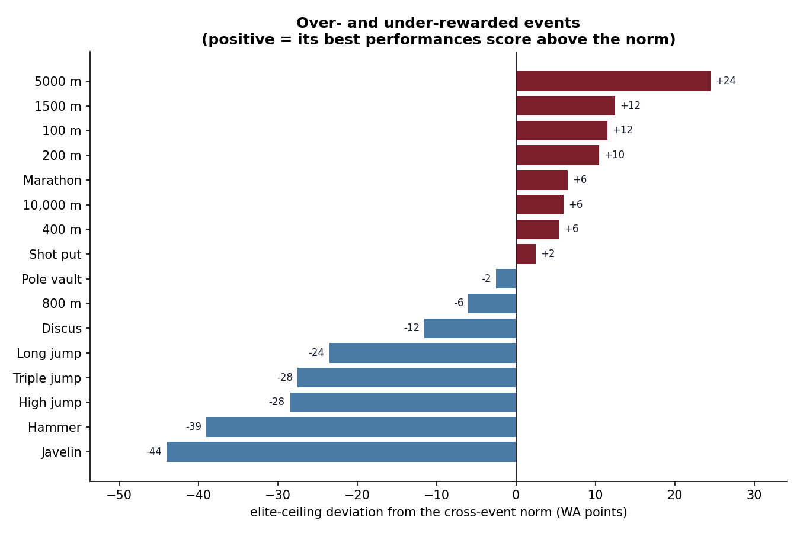

# Auditing the scoring tables: are they fair?

*The number that makes track and field comparable across events, tested against the 2023 and 2024 elite.*

## The assumption

Athletics leans on the World Athletics scoring tables being fair: a 1200-point shot put is meant to be exactly as good as a 1200-point 100 m. The combined events, athlete-of-the-year shortlists and every argument about the best athlete across events depend on that. It is also an empirical claim, and the sport publishes the data to test it.

So I scraped the World Athletics top lists: for 16 events in 2023 and 2024, the top 100 performances for men and for women, each with the WA points it was awarded. That is 6,400 performances, every one carrying the sport's own score. If the tables are fair, the best performers in each event should reach about the same points ceiling.

## The ceiling isn't level

  

I took the 30 highest scores in each event and compared their medians. The 5000 m is highest at 1272 and the 1500 m next at 1260. The javelin is lowest at 1203.5, with the hammer at 1208.5. The spread from top to bottom is 68.5 points. A Kruskal-Wallis test, the rank-based test of whether several samples come from the same distribution, rejects equality at H = 236, p ≈ 10⁻⁴².

The ordering has a pattern. Of the eight events above the cross-event norm (1247.5, the median of the event medians), seven are running events; the shot put is the only field event. Of the eight below it, seven are jumps and throws; the 800 m is the only running event. A 1250-point mark is above the javelin's elite median and below the 5000 m's.

  

## What it does and doesn't prove

An event's elite scores depend on two things at once: how the table converts marks to points, and how deep and competitive the event's current field is. A thinly contested event would show a lower ceiling even under a perfectly fair table, because fewer athletes are pushing its front. The hammer and javelin may be thinner fields than distance running, and this data can't tell those causes apart.

So the defensible reading is that equal WA points don't currently buy equal standing across events, and the gap is some mix of calibration and talent pool. The study doesn't show that any single table is miscoded. To separate the two you would calibrate each table against a fixed frontier, such as the world record, instead of against whoever happens to be competing.

Two smaller caveats. The top 30 pools men and women, so one sex can fill most of an event's elite slice. And two seasons is a short window; a different pair of years could reorder events near the norm.

*Code: [github.com/lyhjeremy/athletics-scoring-fairness](https://github.com/lyhjeremy/athletics-scoring-fairness)*
